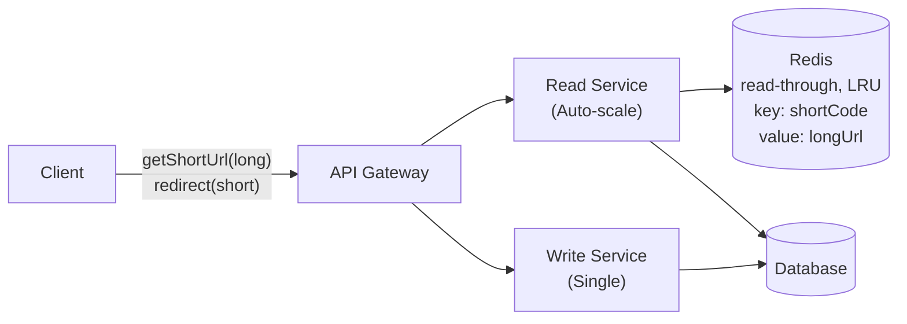
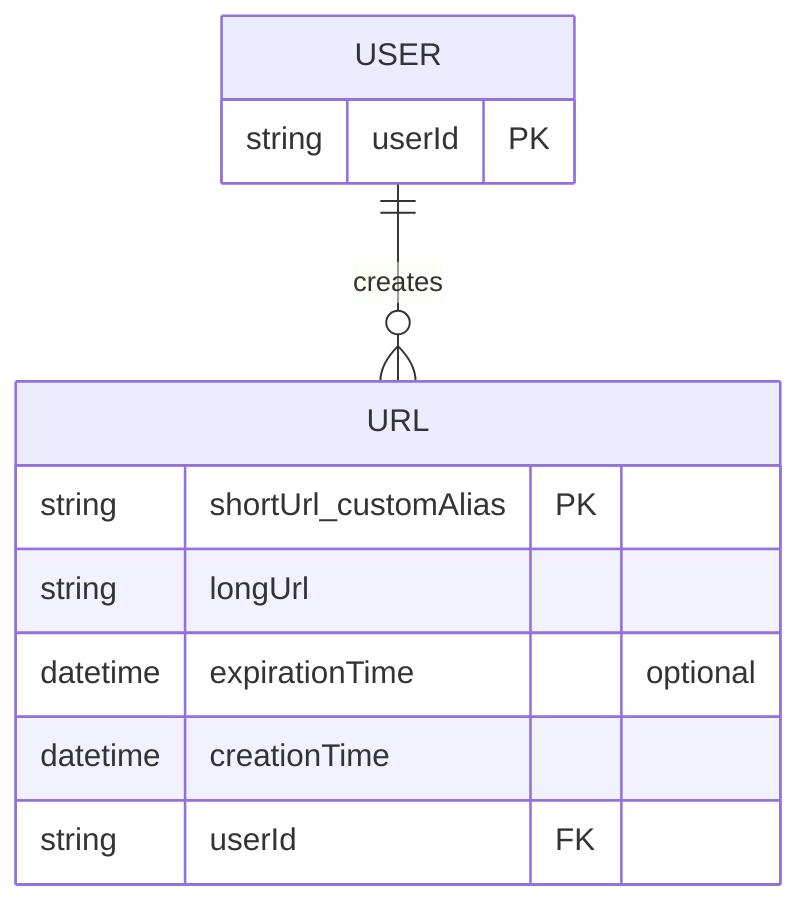

# URL Shortener

Bit.ly is a URL shortening service that converts long URLs into shorter, manageable links.

## 1. Functional Requirements (Core)

- User can create a short URL from a long URL
  - Optionally support a custom alias
  - Optionally support an expiration time
- User can be redirected to the original URL from the short URL

## 2. Non-functional Requirements (Quality)

- Low latency on redirects (~200ms)
- Scale to support 100M DAU and 1B URLs
- Ensure uniqueness of short code
- High availability, eventual consistency for URL shortening

## 3. Core Entities

- Original URL
- Short URL
- User

## 4. API

```
// shorten a URL
POST /urls -> shortUrl
{
    originalURL,
    alias?,
    expirationTime?
}

// redirection
GET {shortUrl} -> Redirect to OriginalUrl
```

Redirect status codes:

- `302` temporary: needed for analytics and logs
- `301` permanent

## 5. High-Level Design



### Data model



## 6. Deep Dives

### Ensure uniqueness of short code

Requirements: fast, unique, short (5-7 chars).

1. **Prefix of the long URL**: bad.
2. **Random number generator (mod)**, at least 10^9 values
   - base62 encoding
   - 62^6 possible combinations = 56B
   - Collision resolution: check the DB for a collision
3. **Hash the long URL**
   - `md5(longUrl)` -> hash -> `base62(hash)[:6]`
   - 62^6 possible combinations = 56B
4. **Counter**
   - Increment a counter -> `base62(num)`
   - No need to check the DB
   - Predictable, which is bad for security
     - Warning: "do not shorten private URLs"
     - Add rate limiting

### Scale to support 100M DAU and 1B URLs

- 100M (10^8) requests / 10^5 seconds per day = 10^3 requests per second, with 10k-100k rps at peak
- Vertical scaling (more CPU)
- Horizontal scaling
  - Many reads (redirect), few writes (create)
- Scale the DB
  - Storage = short code (8) + long URL (100) + creation time (8) + optional URL (100) + expiration (8) = ~500 bytes x 1B rows = 500 GB. Not a lot, so a single instance is fine.
  - Read throughput is fine because Redis absorbs reads.
